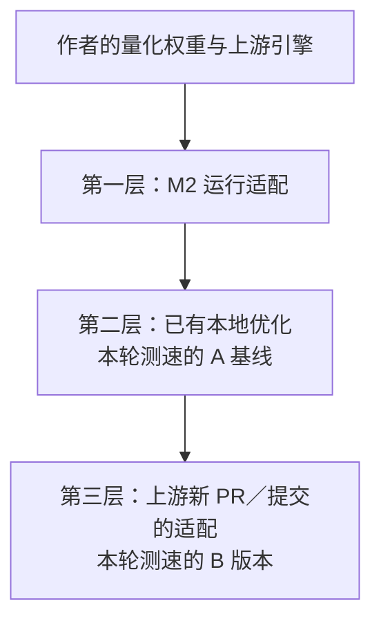

# M2 Ultra + DeepSeek-V4.1-Flash-1017 EXL3 EAQ v1 2.9 bpw

这是面向 **M2 Ultra、192 GiB 统一内存**的 DeepSeek 推理适配与优化项目。我们使用作者提供的量化权重，基于 [mlx-serve](https://github.com/ddalcu/mlx-serve) 和 [mlx-stream](https://github.com/davidtai/mlx-stream) 修改运行时，并参考 [Sushi](https://github.com/beamivalice/sushi) 等项目的实现。

**在我们当时锁定的上游版本和这台 M2 Ultra 上，原样照搬完整推理方案不能完成这套部署。** 量化权重可以直接使用，但默认算子路径、混合位宽适配和引擎集成需要处理。当前版本是在这些适配之上，先积累本地优化，再选择性适配上游的新 PR／提交。

**模型由 DeepSeek-AI 提供，量化由 Mia-AiLab 提供，流式重打包由 OpensourceWTF 提供。** 我们的贡献是 M2 上的运行适配、后续优化及其验证，不是重新训练或制作这份量化。具体来源和署名见 [NOTICE](NOTICE)。

M2 enablement first, established local optimizations second, and selected new upstream-PR adaptations third. See [English overview](docs/README.en.md).

## 我们做了哪三层工作

下面是工程构成和叠加关系：



### 一、先让原方案在 M2 Ultra 上运行

| 需要解决的问题 | 我们的适配 |
| --- | --- |
| 锁定版本中的部分矩阵算子依赖 M2 不具备的 NAX 路径 | 参考 Sushi 的 SIMD 实现，提供 M2 可执行的矩阵计算路径，保留 EXL3 码本与对应数值语义，并核对算子结果 |
| 1017 量化包混合使用 K2／K3，不能直接沿用九月版的 K3-only 适配库 | 在上游混合位宽支持之上迁移 M2 内核，核对每层记录几何、源代码标识、缓冲区和内存预算 |
| 宿主、插件、模型模板和状态生命周期需要协同 | 修改宿主／插件接口、文本与工具协议、请求状态和内存检查，形成可构建、可启动、可使用的完整路径 |

直接复用的是量化权重；算子与推理软件经过了本地适配。上述结论限定于本项目固定的版本与测试环境，不表示所有后续上游版本或其他硬件都有同样限制。

### 二、在可运行版本上积累优化

| 方向 | 已有工作 | 主要作用 |
| --- | --- | --- |
| 输入处理 | 专家缓存命中优先、跨批次处理、输入后缀处理 | 减少输入阶段可避免的等待和重复计算 |
| 生成计算 | M2 专家 Gate／Up 两行复用等已验证算子适配 | 改善相应生成计算路径；是否影响整任务速度仍以实测为准 |
| 连续对话 | 完整回答状态检查点、RAM／SSD 原生状态复用、长前缀身份校验 | 减少连续聊天时重新处理已有上下文 |
| 专家缓存 | 已有缓存记录保留、记录复制和专家统计配置 | 复用已经加载的专家数据 |
| 服务可用性 | 文本／工具接口兼容、流式超时修复、独立日志与回滚 | 让客户端持续可用；这部分不计作生成 TPS 收益 |

这些工作包含对已有项目方法的借鉴、本地实现和验证。它们在最后一次上游方案适配之前已经存在，继续保留在当前版本中。

### 三、再适配上游新 PR／提交中的有效方法

近期工作继续对照作者的新实现，当前合入的是参考 Sushi `dsv41_borrow` 的**选择性专家缓存保留**：在进入输入阶段时只释放预算所需的后部扩展缓存，其余保留供后续生成复用。

这里做了 EXL3／M2 的具体适配：按实际 K2／K3 所有者计算容量，处理 GPU／I/O 同步和 macOS 回收统计延迟，保留原生内存校验，并支持当前 224／288 档位。没有把作者的 STQ 内核、硬件性能或整份新方案直接当成本地实现。实际参考版本固定为 [Sushi b68302a](https://github.com/beamivalice/sushi/blob/b68302a1469ed7d2dab03530cc10c6e2685f2a0a/src/dsv41_borrow.zig)，便于核对。

完整的代码对应关系见 [适配与优化分层说明](docs/ADAPTATIONS.md)。

## 当前版本

| 项目 | 设置 |
| --- | --- |
| 硬件 | M2 Ultra，76 核 GPU，192 GiB 统一内存 |
| 实测系统 | macOS 26.4.1；构建最低目标 26.2 |
| 模型 | DeepSeek-V4.1-Flash-1017，EXL3 EAQ v1 2.9 bpw |
| 输入／生成专家缓存 | 每层 224／288 个槽位 |
| 配置上下文 | 262,144 tokens（256K） |
| 专家 | 全部保留；缓存缺失时从 SSD 读取 |
| DSpark | 保留原有策略与接受规则 |
| 服务范围 | 文字与工具协议；默认仅监听 127.0.0.1 |

224／288 是缓存容量，不是模型的激活专家数。模型仍有每层 384 个路由专家。35 层使用 K3，18–22 层使用 K2；路由专家的 EXL3 权重没有再次量化。

## 第三层适配的增量实测

生成转回输入阶段时，按实际内存预算释放必要的后部扩展缓存，保留其余专家记录，供后续生成复用。保留完整原生预算、同步与回收校验；没有改变权重、采样或投机接受规则。

**A 是已经完成第一、二层工作的本地基线；B 是 A 加上第三层的选择性缓存适配。A 不是未经修改的上游方案。**

下表来自同一台机器、同一缓存档位，现场重新测 A 后测 B。temperature=1、top_p=0.95、seed=42、关闭思考；固定预热，输入与输出逐字一致。**这些百分比只说明第三层相对已有版本的增量，不是整个项目相对原作者方案的累计提升。**

| 场景 | A：已有适配＋优化 | B：再加第三层适配 | 生成速度变化 |
| --- | ---: | ---: | ---: |
| 中文技术说明，生成 1024 tokens | 21.769 tok/s | 22.873 tok/s | +5.1% |
| Python 代码，生成 912 tokens | 29.628 tok/s | 31.465 tok/s | +6.2% |
| 带历史的代码追问，生成 512 tokens | 28.429 tok/s | 32.982 tok/s | +16.0% |
| 三次请求总耗时（不含加载、预热） | 104.152 秒 | 98.017 秒 | −5.9% |
| 进程采样峰值 | 157.161 GiB | 157.139 GiB | 基本不变 |
| 新增 swap | 0 | 0 | — |

完整提示词、回答、计时、源码／程序标识与限制见 [实测 JSON](benchmarks/m2-ultra-224-288-20261026.json) 和 [测速说明](docs/BENCHMARKS.md)。首字时间没有隐去：文字 2.699→3.010 秒，代码 2.669→2.661 秒，追问 2.472→2.546 秒。

**这是一组当前档位的实测，不是所有任务都能达到 35–40 tok/s 的保证。** 256K 是配置和预算范围，这组测速没有填满 256K 输入。

第一层的主要成果是使当时的完整方案在 M2 上可运行；第二层涉及不同阶段、版本和工作负载。现有数据不支持把所有历史改善相加成一个“总提速百分比”。

## 构建与使用

需要 Python 3.9+、Git、Node.js 18+、Zig 0.17.0，以及兼容的 Xcode/Metal 工具链。先阅读 [构建说明](docs/BUILD.md)；这是源码实验版，不提供自动修改系统内存额度的安装器。

```bash
git clone https://github.com/chenwenhao0326-arch/m2-ultra-deepseek-v4.1-flash-1017-exl3-eaq-v1-2.9-bpw.git
cd m2-ultra-deepseek-v4.1-flash-1017-exl3-eaq-v1-2.9-bpw

# 显式获取固定版本的代码与依赖；不下载模型
python3 scripts/prepare.py --profile optimized --download
python3 scripts/setup_deps.py --profile optimized --allow-downloads
python3 scripts/build.py --profile optimized

# MODEL_DIR 指向另行取得的完整流式模型包
python3 scripts/service.py doctor --model "$MODEL_DIR"
python3 scripts/service.py start --profile optimized --model "$MODEL_DIR"
python3 scripts/service.py status
```

页面：`http://127.0.0.1:18000/`；OpenAI 兼容 API：`http://127.0.0.1:18000/v1/`。默认使用独立端口和 `.local/` 运行目录，日志也保存在其中。停止命令：

```bash
python3 scripts/service.py stop
```

模型包使用 [OpensourceWTF 的流式重打包](https://huggingface.co/OpensourceWTF/DeepSeek-V4.1-Flash-1017-streaming-repack-exl3-2.9bpw)，修订 `3ef807df042b7069ccefc0957b6df5ff5fa9267f`，总计约 417.83 GB。它来源于 [Mia-AiLab 的 EXL3 EAQ v1 量化](https://huggingface.co/Mia-AiLab/DeepSeek-V4.1-Flash-1017-EXL3-EAQ-v1-2.9-bpw)。本仓库不包含模型权重，启动脚本也不会自动下载权重。

## 边界与回滚

- 当前新增保留策略适用于不超过 256 个未缓存输入 tokens，或已由引擎验证的长历史短后缀。较大新增输入仍走原流程。
- 保留量取决于实际内存余量；等待 macOS 回收统计可能增加首字延迟。
- 已验证配置为文字服务。多模态和未获得稳定整模型收益的试验保持关闭。
- 进程保护 180 GiB、整机保护 190 GiB；记录内存压力与 swap。测试机器的 GPU 额度设置另见 [运行说明](docs/OPERATIONS.md)。
- 可构建 `baseline`，在相同 224／288／256K 配置下回滚或重测；命令见 [运行说明](docs/OPERATIONS.md)。

## 仓库内容

- `patches/`：前两层工作的宿主／插件补丁，以及单独存放的第三层缓存补丁。
- `m2/`：第一层运行适配和已有 M2 算子优化所用的 C/Metal 源码。
- `config/`：运行参数、模型头指纹、相同初始化用的专家统计。
- `scripts/`：准备、构建、启动、停止和测速。
- `benchmarks/`：经过清理的实测条件与结果。
- `licenses/`：上游及第三方许可与署名。

欢迎提供包含硬件、版本、参数和原始计时的复现报告；后续更新以可复现的证据为依据。
